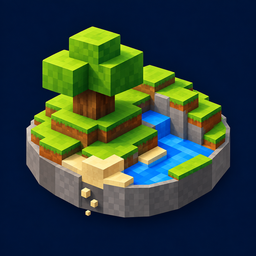
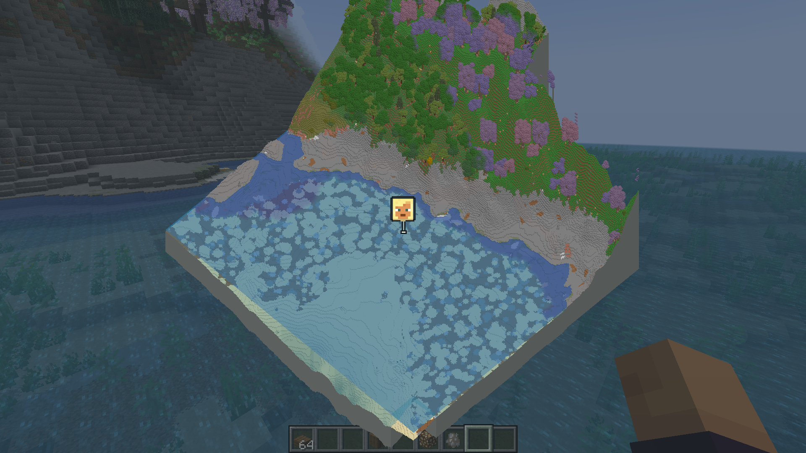
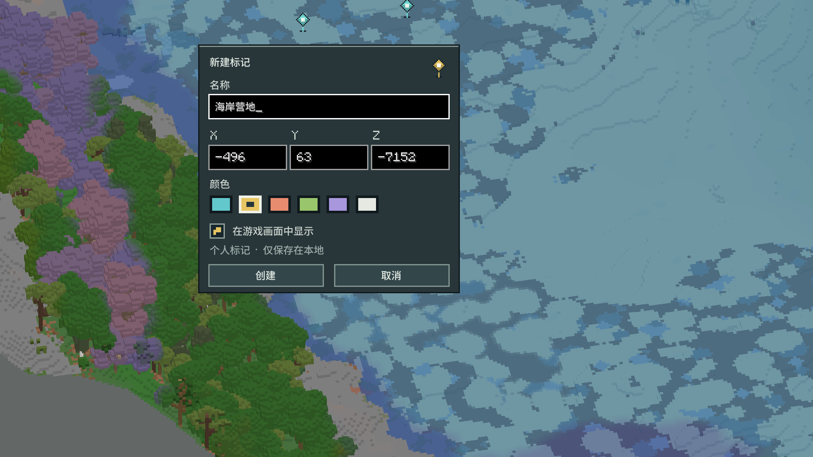
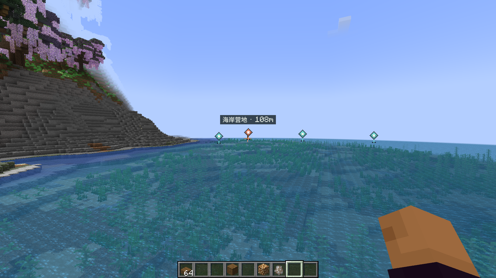

  

<h1 align="center">DS Terrain Map</h1>

把 Minecraft 世界，变成可以旋转、缩放的三维方块沙盘。

  <a href="https://github.com/Assumine/ds-terrain-map/releases">下载测试版</a> ·
  <a href="https://github.com/Assumine/ds-terrain-map/issues">反馈问题</a> ·
  <a href="#安装">安装说明</a>

## 不只是俯视地图

DS Terrain Map 是一个独立的 Minecraft 三维地图模组。地图保留方块地形的高度、
悬崖、树木和建筑轮廓，可以从不同角度观察，而不是将整个世界压成一张平面图片。

- **三维方块沙盘**：拖动、旋转与缩放，观察山地、海岸和建筑的空间关系。
- **大小地图共用缓存**：全屏地图与三维小地图复用地形数据，并将已记录的地图保存在本地。
- **真实材质配色**：根据游戏资源中的材质与着色信息构建地图，不依赖整套预设群系配色。
- **个人航点**：右键地形创建标记，设置名称、XYZ、颜色；可在游戏画面中显示方向标记与距离。
- **可调性能预算**：提供加载线程数、上色并发、后台加载与明暗效果等设置，按电脑性能调整。
- **客户端可独立使用**：普通探索地图不强制要求服务器安装本模组；远端任务走廊等增强功能需要服务端配合。

## 实机效果

### 三维地形与沙盘切面

*Forge 1.20.1 整合包中的真实客户端截图（2026-10-18），展示海岸、植被、水下地形与灰色切面。
不是离线渲染或概念图；具体配色会受到资源包、模组和地图明暗设置影响。*

### 地图内新建标记

*右键地图地形，填写名称与坐标、选择颜色；可以单独关闭游戏内显示。已有标记可再次右键编辑或删除。*

### 在游戏中寻找目的地

*平时保持小图标；注视标记时展开名称与距离，减少遮挡。玩家头像与个人航点使用不同的外形。*

## 安装

本次公开下载提供以下构建：

| 项目 | 要求 |
| --- | --- |
| Minecraft | Java 版 **1.20.1** |
| 加载器 | **Forge 47.4.10 或同一 47.x 分支的更高版本**；实测基准为 47.4.10 |
| Java | **17** |
| 模组版本 | **0.1.0 测试版**（JAR 内版本号为 0.1.0） |
| 模组 ID | `ds_map` |

1. 在 [Releases](https://github.com/Assumine/ds-terrain-map/releases) 下载 `ds-map-forge-1.20.1-0.1.0.jar`。
2. 将 JAR 放入对应 Forge 实例的 `mods` 文件夹。
3. 移除旧版 DS Terrain Map，避免重复安装；启动后检查按键冲突。
4. 进入世界，按 **M** 打开地图。首次记录、取色和建模需要时间，后续可以复用本地缓存。

不需要额外安装 `ds-map-api`。完整 JAR 已内嵌必要的 MixinExtras 依赖。
本次 Release 不提供其他 Minecraft 版本或加载器的下载，不要将此 JAR 安装到 1.21.1、NeoForge 或 Fabric。

### 默认操作

| 操作 | 默认按键/鼠标 |
| --- | --- |
| 打开大地图 | **M** |
| 开关三维小地图 | **N** |
| 切换小地图相机模式 | **B** |
| 小地图放大 / 缩小 | **Shift + + / Shift + -**（主键盘等号 / 减号键） |
| 大地图平移 | 鼠标左键拖动 |
| 大地图旋转 | 鼠标右键拖动 |
| 大地图缩放 | 鼠标滚轮 |
| 回到玩家位置 | 大地图中按 **空格** |
| 新建 / 编辑个人标记 | 在地形 / 已有标记上右键单击 |

按键可在 Minecraft 的按键设置中修改；整合包可能已有其他模组使用相同按键。

## 缓存、后台记录与性能

- 地图缓存与个人标记保存在客户端本地。**个人标记目录为游戏目录下的 `ds-map-markers`**，清理缓存时不要把它一起删除。
- 隐藏小地图不等于关闭后台探索记录；可以在模组配置里单独调整后台加载与预算。
- `/dsmap background on`、`/dsmap background off`、`/dsmap background status` 可控制或查看后台加载状态。
- 线程并非越多越快：较低配置可以先将加载与上色并发调低，再根据 CPU、内存和实际帧率逐步增加。
- 未知区域不等于加载失败。客户端不能凭空获取未收到的远程服务器区块；单机本地存档已有区块可由存档导入路径处理。
- Chunky 负责预生成原版世界区块，并不是地图图片数据库。单机/本地持有对应世界文件时，地图可以复用已生成区块；远程服务端的存档不会自动出现在玩家本机。

## 测试版范围与已知限制

**当前 Beta 以主世界地表探索为重点。洞穴分层、地狱及其他维度的完整适配不在本次支持承诺中。**

- 本次沿用 2026-10-23 的 Forge 1.20.1 构建，该构建已进行后台真实客户端的标记交互与显示验收。
- 这不代表对所有地形、资源包、光影、优化渲染模组和服务器组合做了完整兼容性认证。
- 模组方块会尽量复用原生材质信息，但地图保留简化的方块沙盘表达，不保证逐个还原自定义模型。
- 大型建筑、密集植被及首次冷缓存会增加处理时间；缓存文件也会随着探索增长。
- 本轮发布前检查了 JAR 完整性与版本信息，没有重新启动游戏或重做整合包压力测试。

## 反馈

请在 [Issues](https://github.com/Assumine/ds-terrain-map/issues) 中附上：

- Minecraft、Forge、Java 和 DS Terrain Map 版本；
- 单机或多人、相关模组/资源包/光影，以及可复现的步骤；
- 实际游戏截图，必要时附上经过脱敏的日志。

请不要上传访问令牌、服务器密码、私人服务器地址、个人存档或未经许可的整合包文件。

## 闭源发布

本仓库仅用于发布说明、截图、问题反馈与编译好的模组文件，**不提供模组源代码**。
Releases 页面的 GitHub 自动生成 “Source code” 压缩包仅包含本仓库的说明和图片，不包含开发源码。

本项目采用 **All Rights Reserved**，不是开源项目。详见 [LICENSE](LICENSE)。
第三方依赖保留各自许可，详见 [THIRD_PARTY_NOTICES.md](THIRD_PARTY_NOTICES.md)。

Not an official Minecraft product. Not approved by or associated with Mojang or Microsoft.
